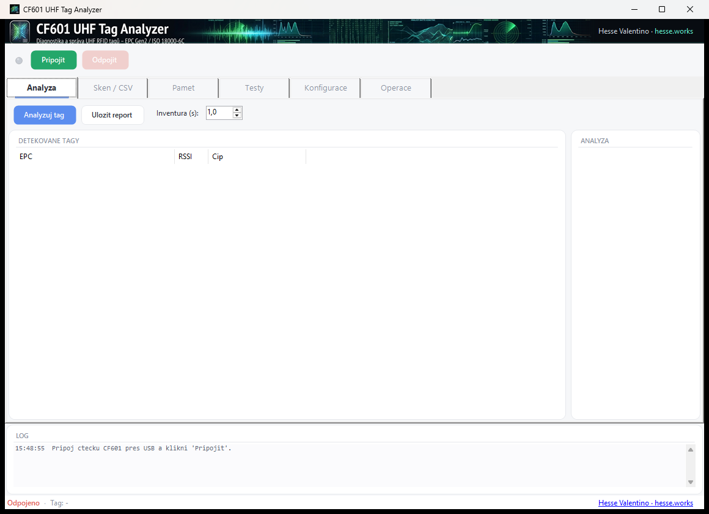
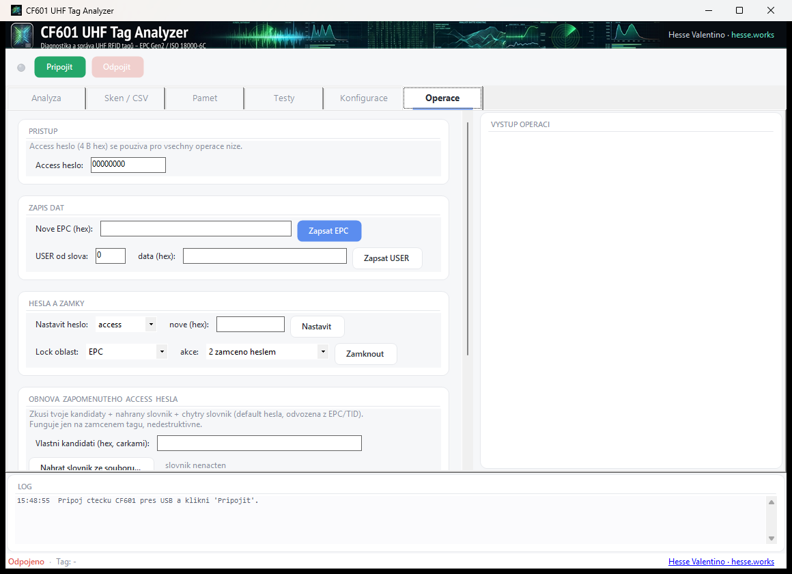
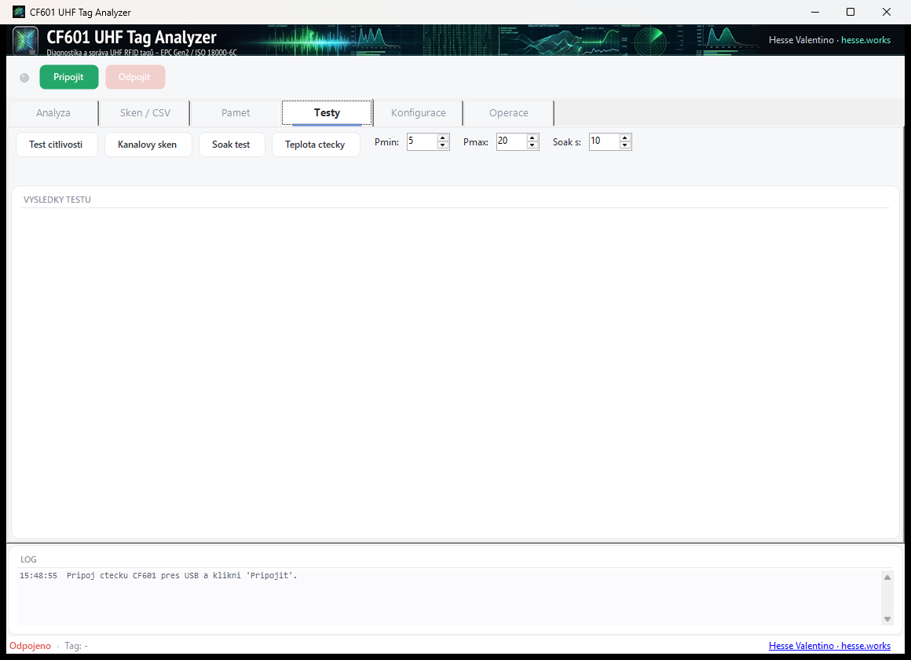
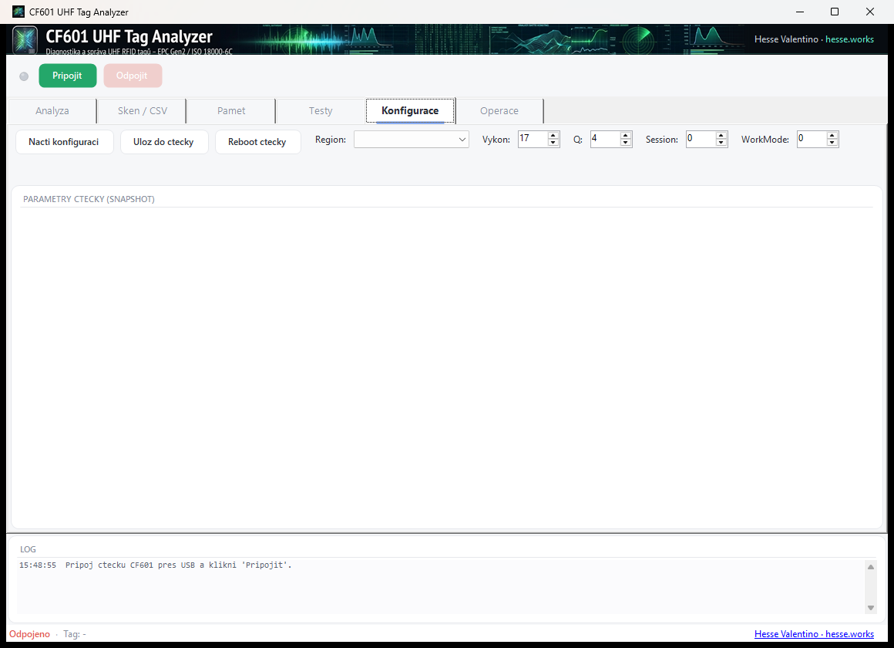

<div align="center">


# UhfTagAnalyzer

**Diagnostický a správcovský nástroj pro UHF RFID tagy** — stolní čtečka **CF601** · EPC Gen2 / ISO 18000‑6C

[](LICENSE)
[](#-požadavky)
[](https://dotnet.microsoft.com/)
[](#-technologie)
[](#-požadavky)
[](#-jak-to-funguje)
[](https://github.com/Hessevalentino/UhfTagAnalyzer-portable/releases/latest)
[](https://github.com/Hessevalentino/UhfTagAnalyzer-portable/releases)

[**⬇ Stáhnout portable**](https://github.com/Hessevalentino/UhfTagAnalyzer-portable/releases/latest) ·
[**📖 Manuál (PDF)**](manual/UhfTagAnalyzer-manual.pdf) ·
[hesse.works](https://hesse.works)

</div>



---

## ✨ Co to je

**UhfTagAnalyzer** je přenosný program pro Windows, který přes USB čtečku **CF601** pracuje
s pasivními **UHF RFID tagy** (EPC Gen2 / ISO 18000‑6C). Přiložíš tag a program z něj vytáhne
**maximum informací** — EPC, výrobce a model čipu, obsah paměti, stav hesel a zámků — a řekne,
jestli je tag **funkční**. Umí tagy i **zapisovat, zamykat, nastavovat hesla, zničit (kill)** a
**obnovit zapomenuté přístupové heslo** vlastního tagu.

> 💡 Žádná instalace, žádné závislosti. Rozbalíš, spustíš `.exe`. Vše potřebné je uvnitř.

## 📋 Obsah

- [Hlavní funkce](#-hlavní-funkce)
- [Screenshoty](#-screenshoty)
- [Stažení](#-stažení)
- [Požadavky](#-požadavky)
- [Spuštění](#-spuštění)
- [Sestavení ze zdrojáku](#-sestavení-ze-zdrojáku)
- [Jak to funguje](#-jak-to-funguje)
- [Struktura projektu](#-struktura-projektu)
- [Technologie](#-technologie)
- [Bezpečnost](#-bezpečnost)
- [Licence](#-licence)

## 🚀 Hlavní funkce

Program je rozdělený do záložek:

| Záložka | Co dělá |
|---|---|
| 🔍 **Analýza** | kompletní rozbor jednoho tagu: detekce, RSSI, PC slovo, **identifikace čipu z TID** (výrobce + model), kontrola CRC, výklad EPC, hesla, USER paměť, **barevný verdikt** funkčnosti |
| 📡 **Sken / CSV** | průběžné skenování více tagů naráz, živý seznam, **export do CSV** |
| 🧠 **Paměť** | kompletní **dump všech 4 bank** (RESERVED / EPC / TID / USER) jako tabulka slov, odvození zámků |
| 🧪 **Testy** | **test citlivosti** (min. výkon pro čtení), **kanálový sken**, **soak test** stability (A–F), teplota čtečky |
| ⚙️ **Konfigurace** | region (EU…), výkon, Q, session, WorkMode, reboot čtečky |
| 🛠️ **Operace** | **zápis EPC/USER**, nastavení hesel, **lock/unlock/permalock**, **kill**, a **obnova zapomenutého hesla** (slovník + maska + vlastní soubor) |

**Identifikace čipů:** Impinj (Monza R6, M7xx…), NXP (UCODE 7/8/9, G2iL…), Alien (Higgs‑3/4/9),
EM Microelectronic, STMicro a další — podle MDID/TMN v TID bance, vždy i se surovým TID.

## 🖼️ Screenshoty

| Analýza | Operace |
|---|---|
|  |  |

| Testy | Konfigurace |
|---|---|
|  |  |

## ⬇ Stažení

Hotovou **přenosnou verzi** (exe + ovladače + PDF manuál) stáhni ze sekce
[**Releases**](https://github.com/Hessevalentino/UhfTagAnalyzer-portable/releases/latest).

Rozbal ZIP a spusť `UhfTagAnalyzer.exe` — nic se neinstaluje.

## 💻 Požadavky

- **Windows 10 / 11** (32‑ i 64‑bit).
- USB čtečka **CF601** (hlásí se jako USB‑HID).
- **Žádný** .NET ani Visual C++ redistributable — runtime je zabalený v exe.

> Program je **32bitový (x86)**, protože nativní ovladač čtečky `UHFPrimeReader.dll` je x86.
> Na 64bit Windows běží bez problému.

## ▶ Spuštění

1. Zkopíruj celou složku (nebo rozbal ZIP z Releases) kamkoli na disk.
2. Spusť **`UhfTagAnalyzer.exe`**.
3. Zapoj CF601 do USB → klikni **Připojit** → přilož tag → **Analyzuj tag**.

> ⚠️ Tři soubory `UhfTagAnalyzer.exe`, `UHFPrimeReader.dll`, `hidapi.dll` musí zůstat
> **pohromadě**. Jinak program hlásí „Dll was not found".

## 🔧 Sestavení ze zdrojáku

Potřebuješ **.NET SDK 9** (nebo novější).

```bash
# klon
git clone https://github.com/Hessevalentino/UhfTagAnalyzer-portable.git
cd UhfTagAnalyzer-portable

# sestavení přenosného single-file EXE (x86)
dotnet publish -c Release -r win-x86 --self-contained true -o publish
```

Nebo prostě spusť `build.cmd`. Výsledek je v `publish/`.

## 🧩 Jak to funguje

- Čtečka **CF601 se připojuje přes USB‑HID**, ne jako COM port — proto se **nevybírá žádný
  port ani baud rate**. Program zavolá `CFHid_GetUsbCount()` a otevře první čtečku
  (`OpenHidConnection`).
- Komunikace probíhá přes nativní knihovnu `UHFPrimeReader.dll` (P/Invoke).
- **Identifikace čipu** se počítá z TID banky (pole MDID = výrobce, TMN = model dle EPC Tag
  Data Standard).
- **Obnova hesla** funguje jako nedestruktivní *orákulum*: na zamčeném tagu zkouší zapsat zpět
  stejná data různými hesly; projde jen to správné.

Podrobnosti v [manuálu (PDF)](manual/UhfTagAnalyzer-manual.pdf) — 19 stran včetně teorie
EPC Gen2, paměťových bank, hesel a zámků.

## 📁 Struktura projektu

```
├─ Program.cs          vstupní bod + resolver nativních DLL
├─ MainForm.cs         GUI (záložky, log, status)
├─ Theme.cs            vzhled (banner, tlačítka, karty, LED)
├─ NativeApi.cs        P/Invoke vazby na UHFPrimeReader.dll + struktury
├─ Reader.cs           připojení, inventura, čtení bank, analýza
├─ Operations.cs       zápis, lock, kill, testy, obnova hesla
├─ TagDecode.cs        dekodéry PC/TID/EPC + databáze čipů + CRC
├─ native/             UHFPrimeReader.dll, hidapi.dll (x86)
└─ manual/             zdroj a PDF uživatelského manuálu
```

## 🛠️ Technologie


- **C# / .NET 9 WinForms** — desktopové GUI
- **P/Invoke** — volání nativní čtečkové knihovny
- **EPC Gen2 / ISO 18000‑6C** — standard UHF RFID
- Vlastní vykreslování UI (banner, karty, tlačítka) bez externích UI knihoven

## 🔐 Bezpečnost

Některé operace jsou **nevratné** — čti, než klikneš:

- **KILL** zničí tag navždy.
- **PERMALOCK** trvale zamkne banku, neobejde se ani heslem.
- Přepsání EPC/USER přemaže původní obsah.

Funkce **obnovy hesla** je určena pro **vlastní tagy** (zapomenuté heslo) — je to provozní
nástroj, ne prostředek k obcházení cizího zabezpečení.

## 📄 Licence

Vydáno pod licencí **[MIT](LICENSE)**.

Nativní knihovny `UHFPrimeReader.dll` a `hidapi.dll` pocházejí z SDK výrobce čtečky a nejsou
kryty touto licencí (přiloženy pro funkčnost).

---

<div align="center">

**Hesse Valentino** · [hesse.works](https://hesse.works)

Když ti projekt pomohl, nech ⭐ hvězdu.

</div>
