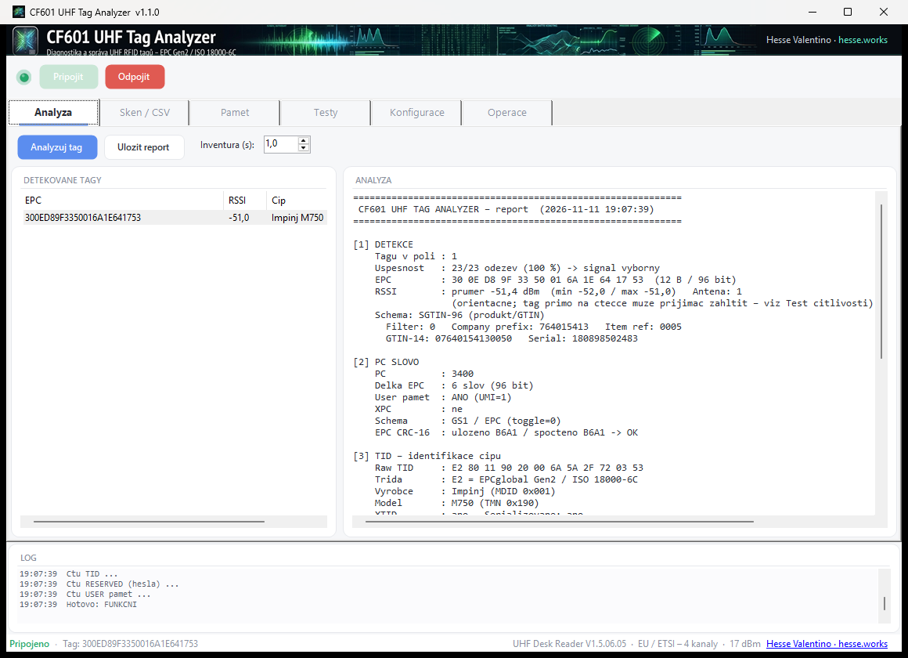
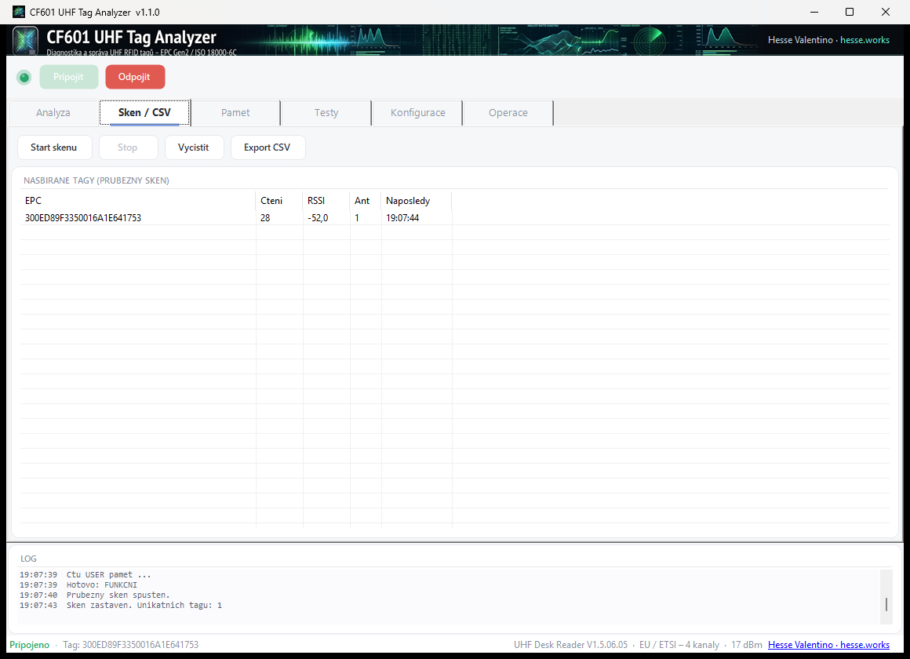
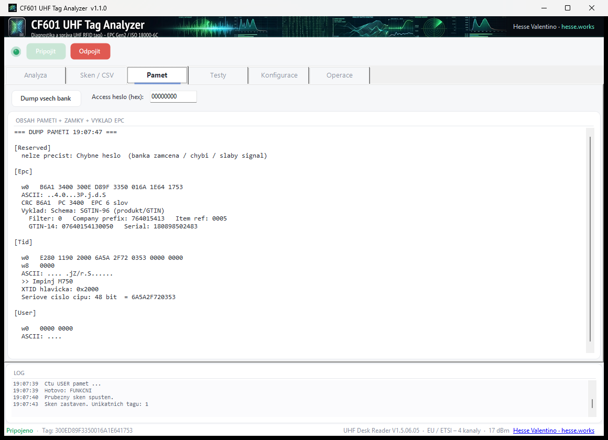
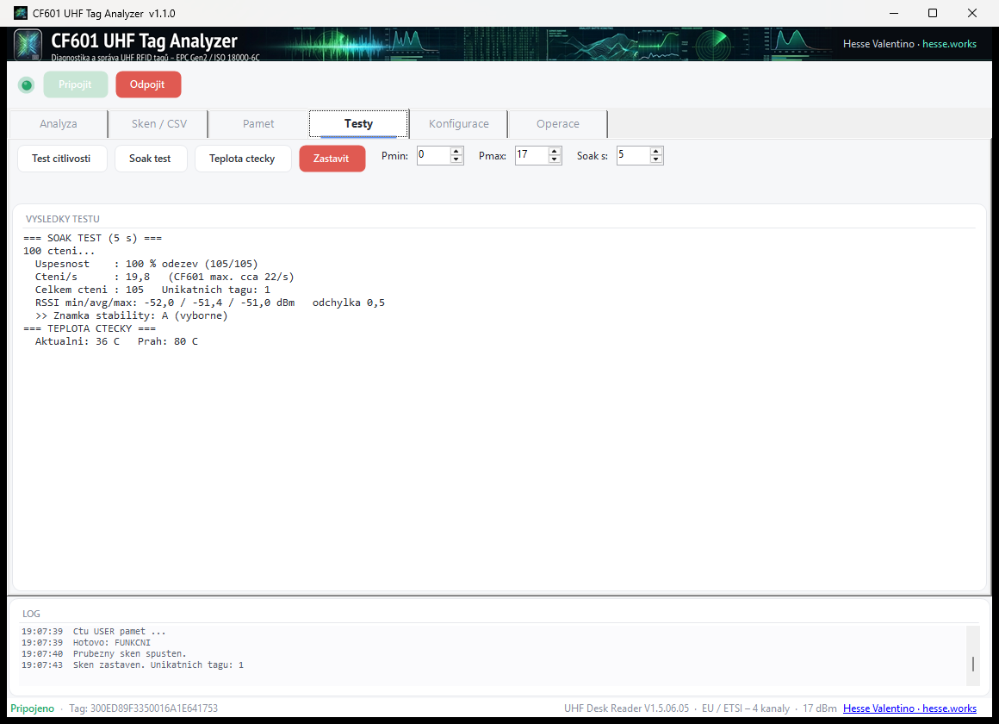
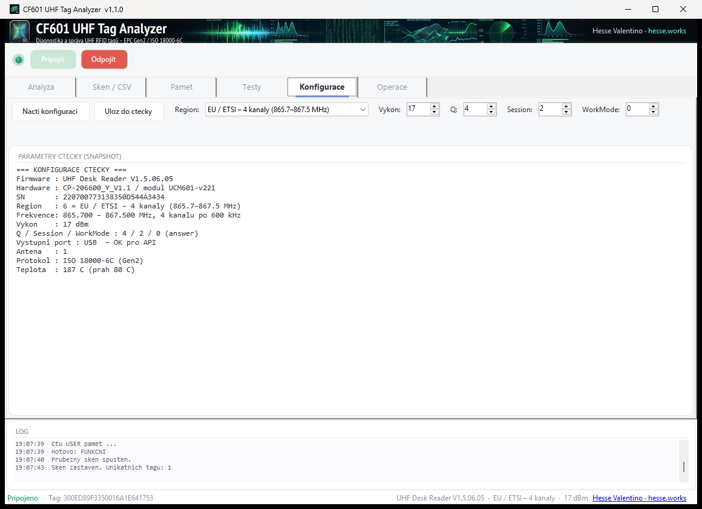
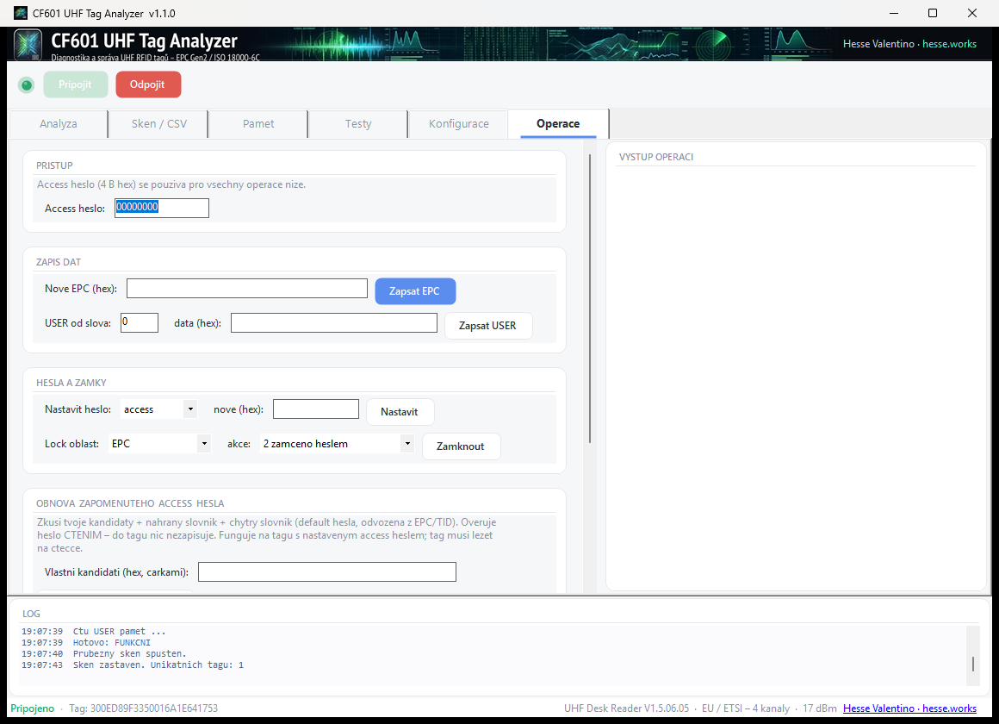

## O tomto manuálu

Tento dokument je kompletní uživatelská i technická příručka k programu **UhfTagAnalyzer** (verze 1.1.0) –
diagnostickému a správcovskému nástroji pro UHF RFID tagy čtené stolní čtečkou **CF601**.

Manuál je psaný tak, abys po jeho přečtení **rozuměl celému systému** – nejen které tlačítko
zmáčknout, ale i *co se děje uvnitř tagu a čtečky* a *proč* se věci chovají, jak se chovají.
Je rozdělený na dvě roviny:

- **Prakticky** – jak program ovládat, co dělá každá záložka, krok za krokem.
- **Do hloubky** – jak funguje EPC Gen2, paměťové banky, hesla, zámky, identifikace čipu.

Pokud chceš jen rychle začít, přečti si kapitoly *Instalace a spuštění* a *Připojení ke čtečce*
a pak záložku *Analýza*. Zbytek je referenční – vrátíš se k němu, až ho budeš potřebovat.

Všechny obrázky v manuálu jsou ze skutečné čtečky CF601 a skutečného tagu (Impinj M750).
{: .box }

---

## 1. Úvod

### 1.1 Co je UhfTagAnalyzer

UhfTagAnalyzer je program pro **Windows**, který přes čtečku CF601 pracuje s pasivními
**UHF RFID tagy** (štítky) standardu **EPC Gen2 / ISO 18000-6C**. Umožňuje:

- **přečíst tag a zjistit o něm maximum** – jeho EPC kód, výrobce a model čipu, unikátní sériové
  číslo čipu, obsah paměti, stav hesel,
- **posoudit, zda je tag funkční**,
- **zapisovat** do tagu (EPC, uživatelská data), **zamykat** paměť, nastavovat **hesla**,
  v krajním případě tag **nevratně zničit** (kill),
- **obnovit zapomenuté přístupové heslo** vlastního tagu – **pouze čtením**, bez zápisu do tagu,
- **testovat tagy** (citlivost, stabilita čtení) a čtečku (teplota),
- **hromadně skenovat** více tagů a exportovat je do CSV.

### 1.2 Pro koho je určen

Pro každého, kdo pracuje s UHF RFID štítky – ve skladu, výrobě, laboratoři, při vývoji nebo
servisu. Nepředpokládá hluboké znalosti RFID; vše potřebné vysvětluje kapitola 2.

### 1.3 Co je to vlastně „tag"

RFID tag (štítek, transpondér) je malý čip s anténou. **Pasivní** UHF tag nemá baterii –
energii i povel dostává rádiem ze čtečky. Čtečka vyšle pole, tag se „probudí", napájí se z něj
a odpovídá zpět. Proto má dosah jen několik centimetrů až metrů a proto na kvalitě signálu
tolik záleží.

---

## 2. Jak funguje UHF RFID (teorie, kterou chceš znát)

Tato kapitola je srdcem pochopení celého programu. Bez ní jsou pojmy jako *PC slovo*, *TID*
nebo *lock* jen tlačítka; s ní budeš vědět, co děláš.

### 2.1 Standard EPC Gen2 / ISO 18000-6C

UHF tagy, se kterými CF601 pracuje, dodržují standard **EPC Gen2** (shodný s ISO 18000-6C).
Pracují v pásmu **860–960 MHz**; v **EU/ČR je povolené jen pásmo 865–868 MHz**. Standard
určuje, jak tag komunikuje, jak je uspořádaná jeho paměť a jaké příkazy umí (čtení, zápis,
zámek, kill).

### 2.2 Paměť tagu – čtyři banky

Paměť každého EPC Gen2 tagu je rozdělená do čtyř **bank**. Toto je nejdůležitější tabulka
celého manuálu – vrátíš se k ní u záložek Paměť a Operace:

| Banka | Číslo | Co obsahuje |
|---|---|---|
| **RESERVED** | 0 | **Kill heslo** (slova 0–1) a **Access heslo** (slova 2–3). Každé 32 bitů. |
| **EPC** | 1 | **CRC** (slovo 0), **PC slovo** (slovo 1) a vlastní **EPC kód** (od slova 2). |
| **TID** | 2 | **Tag ID** – z výroby napevno. Určuje výrobce a model čipu, obvykle i unikátní sériové číslo čipu. |
| **USER** | 3 | **Uživatelská paměť** – volná pro tvoje data. Velikost se liší podle čipu (0 až stovky bitů). |

Paměť se adresuje po **slovech** (1 slovo = 16 bitů = 2 bajty). Když tedy čteš „od slova 2,
2 slova", čteš bajty na pozicích 4–7.

> **Pozor – čipy se liší.** Některé čipy mají jen **jedno sdílené heslo** (např. Impinj M730/M750/M770:
> kill a access heslo jsou totéž – změna jednoho změní i druhé). Jiné hesla **vůbec nemají**
> (Impinj Monza R6). Program tyto zvláštnosti u rozpoznaných čipů v reportu sám uvede.

### 2.3 EPC kód

**EPC** (Electronic Product Code) je „číslo tagu" – to, co se při inventuře čte jako první.
Může to být náhodné ID, nebo strukturovaný kód podle GS1 (např. **SGTIN‑96** nese globální
číslo produktu GTIN + sériové číslo). Typicky má 96 bitů (12 bajtů), ale délka je proměnná.
EPC **lze přepsat** – proto podle něj nikdy neurčuj, o jaký tag jde.

### 2.4 PC slovo (Protocol Control)

Před EPC je v bance 1 jedno **PC slovo**. Je to „hlavička", která tagu i čtečce říká:

- **délku EPC** (horních 5 bitů) – kolik slov EPC má,
- **UMI** (User Memory Indicator) – jestli tag má uživatelskou paměť,
- **XPC** – zda je přítomno rozšířené PC,
- **toggle** – jestli je EPC formátu GS1/EPC, nebo ISO.

Program PC slovo čte přímo z paměti tagu a rozkládá ho. Když měníš EPC, program v PC slově
**změní jen délku** a ostatní bity (UMI, toggle, AFI) zachová.

### 2.5 CRC – kontrola integrity

**CRC‑16** je kontrolní součet uložený v bance EPC. Program ho **přepočítá** z PC+EPC a
porovná s tím, co je v tagu. Shoda = data v tagu nejsou poškozená. Neshoda může znamenat
poškozený tag nebo chybu čtení.

### 2.6 TID – rodný list čipu

**TID** (banka 2) je z výroby **napevno a nezměnitelně** zapsané ID čipu. Program z něj pozná:

- **třídu** – `E2` znamená EPC Gen2 / ISO 18000‑6C,
- **výrobce** (pole MDID) – podle registru GS1 (Impinj, NXP, Alien, EM Microelectronic, …),
- **model čipu** (pole TMN) – např. Impinj M750, Monza R6, NXP UCODE 8/9, Alien Higgs‑3,
- **unikátní sériové číslo čipu** (48 bitů) – z rozšířeného TID (XTID).

Protože TID nejde změnit a čte se vždy, je to spolehlivý ukazatel, **co přesně máš za tag**.
Když se TID nedá přečíst, je to varovný signál – obvykle slabý signál nebo vadný čip.

### 2.7 Hesla a zámky

Tag má (obvykle) dvě 32bitová hesla v bance RESERVED:

- **Access heslo** – „klíč" k zamčeným bankám. Se správným access heslem lze číst/zapisovat
  oblasti, které jsou jinak uzamčené.
- **Kill heslo** – slouží k **nevratnému zničení** tagu (příkaz kill).

**Zámky (lock)** určují, co jde s danou bankou dělat. Pro každou oblast lze nastavit:

| Akce | Význam |
|---|---|
| **odemčeno** | zápis volně, bez hesla |
| **trvale odemčeno** | navždy zapisovatelné, nelze už zamknout |
| **zamčeno heslem** | zápis jen se správným access heslem |
| **PERMALOCK** | **trvalý zámek – nevratné, neobejde se ani heslem** |

Toto je klíč k pochopení záložky Operace i obnovy hesla. **Permalock je definitivní** – co
permalocknete, už nikdy nezměníte.

---

## 3. Čtečka CF601

| Parametr | Hodnota |
|---|---|
| Typ | stolní UHF RFID čtečka / zapisovačka |
| Připojení | **USB** (hlásí se jako **HID** zařízení) |
| Protokol | EPC Gen2 / ISO 18000‑6C |
| Pásmo | 860–960 MHz – **v EU nastav region EU (865–868 MHz)** |
| Vysílací výkon | 0–17 dBm |
| Čtecí dosah | přibližně **1–35 cm** |
| Napájení | z USB (5 V) |

Čtečka se k PC připojuje přes USB a program s ní komunikuje přes nativní knihovnu
`UHFPrimeReader.dll` (+ `hidapi.dll`). Žádné ovladače se neinstalují – Windows HID zařízení
rozpozná samo.

### 3.1 Co program nastavuje sám

CF601 přichází z výroby nastavená jako **„klávesnice"**: sama dokola čte tagy a jejich EPC
„píše" jako klávesy do aktivního okna. V tomto režimu s ní program nemůže pracovat. Proto při
každém **Připojit** program automaticky:

- přepne výstup čtečky na **USB** a pracovní režim na **odpovědní** (`WORKMODE = 0`),
- počká, až se čtečka po přepnutí znovu přihlásí na USB, a připojí se znovu,
- zkontroluje **region** – když čtečka nevysílá v pásmu EU, nabídne přepnutí jedním kliknutím.

Nic z toho nemusíš dělat ručně. Čtečka si nastavení pamatuje; při běžném připojení už jen
proběhne kontrola.
{: .box }

### 3.2 Co je dobré o CF601 vědět

- **Dosah až 35 cm.** Tag ležící na stole vedle čtečky se čte také. Při analýze jednoho tagu
  měj ostatní tagy dál.
- **RSSI (síla signálu) je jen orientační.** Když tag leží přímo na čtečce a čtečka vysílá
  plným výkonem, přijímač se zahltí a hlásí nesmyslných −90 dBm. Program to pozná a v reportu
  upozorní. Spolehlivé měřítko síly odezvy tagu je **Test citlivosti**.
- **Výrobní nastavení session = 2.** Inventura si tag „zapamatuje"; následné čtení paměti proto
  program vždy cílí na konkrétní tag podle jeho EPC. Děje se to automaticky.

---

## 4. Instalace a spuštění

### 4.1 Co potřebuješ

Program je **přenosný** – nic se neinstaluje. Potřebuješ jen jeho složku se **třemi soubory**:

```
UhfTagAnalyzer.exe      – samotný program (.NET runtime je uvnitř)
UHFPrimeReader.dll      – ovladač čtečky
hidapi.dll              – závislost pro USB
```

- Běží na **Windows 10/11** (32‑ i 64‑bitových). Program je 32bitový, protože ovladač čtečky je
  32bitový – na 64bit Windows poběží bez problému.
- **Nepotřebuje** nainstalovaný .NET ani Visual C++ redistributable. Vše potřebné je uvnitř.

### 4.2 Spuštění

1. Zkopíruj celou složku (nebo rozbal `UhfTagAnalyzer-portable.zip`) kamkoli na disk.
2. Spusť **`UhfTagAnalyzer.exe`** dvojklikem. Verze programu je vidět v titulku okna.

> **Důležité:** všechny tři soubory musí zůstat **pohromadě ve stejné složce**. Kdyby exe
> zůstal bez `UHFPrimeReader.dll`, program při připojení ohlásí „Dll was not found".

---

## 5. Přehled rozhraní



Okno má pevnou strukturu, která je stejná ve všech záložkách:

- **Hlavička** (nahoře) – banner s názvem programu a podpisem autora.
- **Panel připojení** – kontrolka (LED), tlačítko **Připojit** (zelené) a **Odpojit** (červené).
- **Záložky** – Analýza, Sken / CSV, Paměť, Testy, Konfigurace, Operace.
- **Pracovní plocha** – obsah aktivní záložky.
- **Log** (dole) – průběžný záznam toho, co program dělá, s časem.
- **Stavový řádek** (úplně dole) – stav připojení, vybraný tag, firmware čtečky, region a výkon.

**LED kontrolka** vedle tlačítka Připojit je šedá, když je čtečka odpojená, a **zelená**, když
je připojená.

---

## 6. Připojení ke čtečce

1. Zapoj CF601 do USB.
2. Klikni na **Připojit**.
3. Program čtečku najde (přes USB‑HID), připraví ji (viz kapitola 3.1) a do stavového řádku
   vypíše **firmware, region a výkon**. LED zezelená, stav se změní na „Připojeno".

Připojení trvá obvykle 1–3 s, při první úpravě čtečky (přepnutí z režimu klávesnice) i déle.
Okno mezitím nezamrzá. Průběh je vidět v logu.

Když čtečka vysílá mimo pásmo EU, program se zeptá, jestli ji má přepnout na **EU / ETSI**.
Doporučená odpověď je **Ano**.

Když čtečka není nalezena, program zobrazí hlášku „CF601 nenalezena na USB" – zkontroluj kabel
a jiný USB port.

Po skončení práce klikni **Odpojit**. Při zavření okna se čtečka odpojí automaticky; když
zrovna běží nějaká operace, program počká, až doběhne.

---

## 7. Záložka Analýza

Nejdůležitější záložka. Přiložíš tag a klikneš **Analyzuj tag** – program provede kompletní
rozbor jednoho tagu (asi 2 s) a vypíše přehledný report. Tím se tag zároveň „vybere" pro
ostatní záložky.


- **Inventura (s)** – jak dlouho program tag „poslouchá" (výchozí 1,0 s).
- **Analyzuj tag** – spustí rozbor.
- **Uložit report** – uloží výsledek jako textový soubor (.txt).
- Vlevo je **seznam detekovaných tagů** (EPC, RSSI, čip), vpravo **report**.

### 7.1 Jak číst report

Report má šest sekcí:

**[1] Detekce** – kolik tagů je v poli, **úspěšnost čtení v %** (kolikrát tag odpověděl z počtu
pokusů → kvalita spojení), EPC a jeho výklad (např. SGTIN‑96 → GTIN a sériové číslo) a
**RSSI** (průměr / min / max). RSSI je jen orientační – viz kapitola 3.2. Když je hodnota na
spodní mezi čtečky (−90 dBm) a tag přitom čte spolehlivě, report upozorní na **saturaci**
(tag je příliš blízko antény).

**[2] PC slovo** – PC přečtené z paměti tagu: délka EPC, **UMI**, XPC, schéma GS1/ISO a
**kontrola EPC CRC‑16** (OK = data konzistentní).

**[3] TID – identifikace čipu** – surové TID, třída, **výrobce a model čipu**, unikátní
**sériové číslo čipu**, velikost paměti čipu podle datasheetu výrobce a případné **poznámky**
(např. sdílené heslo u Impinj M700). Toto odpovídá na otázku „co přesně je to za tag".

**[4] RESERVED – hesla** – stav kill a access hesla:

- *default / nenastaveno* (samé nuly) nebo *nastaveno* (hodnota je vidět),
- **zamčeno heslem** – tag odmítl čtení bez hesla, tj. má nastavené access heslo a banka je
  chráněná,
- u **Monza R6** program upozorní, že čip hesla nemá (nečitelná RESERVED tam nic neznamená).

**[5] USER paměť** – skutečná velikost (program ji zjistí čtením) a obsah (hex + ASCII).

**[6] Verdikt** – kontroly (detekce, stabilita čtení, čitelnost TID, CRC) a barevný závěr:

| Verdikt | Význam |
|---|---|
| **FUNKČNÍ** (zeleně) | tag čte spolehlivě, TID i CRC v pořádku |
| **ČÁSTEČNĚ FUNKČNÍ** (oranžově) | tag reaguje, ale slabě / nestabilně |
| **NEFUNKČNÍ** (červeně) | tag se nepodařilo spolehlivě přečíst – vadný nebo mimo dosah |

RSSI se do verdiktu **nepočítá** (u CF601 není spolehlivé).

> Když je v poli víc tagů, program analyzuje ten **nejčastěji čtený** a ostatní vypíše do
> seznamu. Pro čistý rozbor měj u čtečky jen jeden tag.

---

## 8. Záložka Sken / CSV

Slouží k **hromadnému, průběžnému skenování** více tagů a jejich evidenci.



- **Start skenu** – spustí průběžné čtení. Do seznamu přibývají **unikátní tagy** s počtem
  čtení, RSSI, anténou a časem posledního záznamu.
- **Stop** – zastaví sken.
- **Vyčistit** – smaže seznam.
- **Export CSV** – uloží nasbírané tagy do CSV souboru (oddělovač `;`) pro Excel nebo evidenci.

Hodí se na inventuru, ověření čtivosti většího počtu štítků nebo sběr dat o tazích.

---

## 9. Záložka Paměť

Kompletní **výpis (dump) všech čtyř bank** tagu – pro hlubší pohled, než dává záložka Analýza.



- **Access heslo (hex)** – pokud je některá banka chráněná heslem, zadej ho sem.
- **Dump všech bank** – přečte RESERVED, EPC, TID i USER **až do jejich konce** (velikost
  bank program zjistí sám) a vypíše je jako **tabulku slov**, ASCII náhled a výklad
  (CRC, PC, délka EPC, výklad EPC, model čipu a sériové číslo z TID).

Dump pracuje s tagem vybraným v Analýze. Když některou banku nelze přečíst, program napíše
proč – banka je zamčená heslem, tag ji nemá, nebo je slabý signál. I to je informace.

---

## 10. Záložka Testy

Diagnostika rádiové části – pomáhá ladit umístění tagu a posoudit jeho kvalitu.



### 10.1 Test citlivosti

Hledá **minimální vysílací výkon, při kterém tag ještě odpoví** – přímá míra citlivosti tagu
a kvality jeho antény (čím nižší, tím lepší; tento údaj je spolehlivější než RSSI).

Test jde **od Pmax dolů** a skončí po dvou krocích za sebou bez čtení – trvá asi 20–40 s.
Po skončení program **vrátí původní výkon** čtečky a ověří ho; kdyby se to nepodařilo,
napíše to do výsledků.

### 10.2 Soak test

Měření stability čtení v čase (délku zadáš v „Soak s"). Ukáže **úspěšnost odezev v %**, počet
čtení za sekundu (CF601 zvládne zhruba 20–22 čtení/s) a rozptyl RSSI a přidělí **známku
stability A–F** podle úspěšnosti.

### 10.3 Teplota čtečky

Přečte aktuální teplotu čtečky a teplotní práh – pro kontrolu, že se čtečka nepřehřívá.

### 10.4 Zastavit

Tlačítko **Zastavit** přeruší běžící test citlivosti nebo soak test.

---

## 11. Záložka Konfigurace

Čtení a nastavení parametrů čtečky.



- **Načti konfiguraci** – zobrazí snapshot: firmware, hardware, SN, region a frekvence,
  výkon, Q, session, pracovní režim, výstupní port, anténa, protokol, teplota.
- **Ulož do čtečky** – zapíše nastavené parametry (nejdřív je potřeba konfiguraci načíst).

Nastavitelné parametry:

| Parametr | Co dělá |
|---|---|
| **Region** | frekvenční pásmo. V ČR/EU zvol **EU / ETSI – 4 kanály (865,7–867,5 MHz)**. Program nastaví region i celou frekvenční tabulku. |
| **Výkon** | vysílací výkon v dBm (CF601: 0–17). |
| **Q** | parametr antikolize – ovlivňuje čtení více tagů najednou. |
| **Session** | relace EPC Gen2 (0–3). Výchozí 2 ponech. |
| **WorkMode** | pracovní režim. **Musí být 0** – jinak program neumí číst tagy (při dalším připojení ho sám vrátí). |

> **Region je důležitý i právně.** V EU je pro UHF RFID povolené jen pásmo 865–868 MHz.
> Z výroby může být čtečka nastavená na jiné pásmo (např. USA 902–928 MHz).

---

## 12. Záložka Operace

Zde se tag **mění**. Všechny akce pracují s tagem vybraným v záložce Analýza a používají
**Access heslo** z horní sekce. Nebezpečné akce vyžadují potvrzení.



Program u každé operace vyhodnocuje **skutečnou odpověď tagu** – „OK" znamená, že tag operaci
opravdu provedl, ne jen že čtečka přijala příkaz.

### 12.1 Přístup

Políčko **Access heslo (hex)** – 4 bajty (8 hex znaků), např. `00000000` (lze psát i s `0x`).
Použije se pro všechny operace níže.

### 12.2 Zápis dat

- **Zapsat EPC** – přepíše EPC tagu. Zadáš nový EPC v hex (po celých slovech, tj. sudý počet
  bajtů). Program v PC slově změní jen délku EPC a ostatní bity zachová. Po úspěchu se vybraný
  tag v programu přepne na nové EPC.
- **Zapsat USER** – zapíše data do uživatelské paměti od zvoleného slova.

### 12.3 Hesla a zámky

- **Nastavit heslo** – zapíše nové **access** nebo **kill** heslo (4 bajty hex) do banky
  RESERVED. U čipů se **sdíleným heslem** (Impinj M700) program před změnou upozorní, že se
  změní obě hesla.
- **Zamknout** – nastaví zámek vybrané oblasti (Kill heslo / Access heslo / EPC / TID / USER)
  na zvolenou akci (odemčeno / trvale odemčeno / zamčeno heslem / **PERMALOCK**).

> **Pozor na PERMALOCK.** Je **nevratný**. Permalocknutou oblast už nikdy nezměníš, ani se
> správným heslem. Program před permalockem vyžaduje potvrzení – ber ho vážně.

### 12.4 Kill tag

**KILL TAG** tag **nevratně zničí** – po killu už nikdy neodpoví na žádný příkaz. Používá KILL
heslo (zadané v poli „nové (hex)" v sekci Hesla, jinak Access heslo). Kill s nulovým heslem
není povolen. Program vyžaduje potvrzení.

> Zničený tag se **nedá obnovit**. Kill používej jen vědomě a na správném tagu.

---

## 13. Obnova zapomenutého access hesla

Sekce **Obnova zapomenutého access hesla** (v záložce Operace) pomáhá, když jsi zapomněl
přístupové heslo **vlastního** tagu.

### 13.1 Jak to funguje (princip orákula)

Tag ti nikdy neřekne, jestli je heslo správné. Program proto používá **orákulum** – operaci,
která uspěje jen se správným heslem. Využívá chování standardu Gen2: když čtečka čte s
nenulovým heslem, nejdřív tag „odemyká" příkazem *Access*. **Se špatným heslem čtení selže,
se správným projde.**

1. Program ověří, že tag odpovídá (kontrolní čtení TID bez hesla).
2. Když je banka RESERVED čitelná bez hesla, heslo rovnou **vyčte** a skončí.
3. Jinak pro každé kandidátní heslo zkusí **přečíst TID s tímto heslem**:
   - špatné heslo → čtení selže → zkouší další,
   - správné heslo → čtení projde → **heslo nalezeno**.
4. Nalezené heslo **potvrdí** přečtením banky RESERVED (ta se se správným heslem odemkne).

Do tagu se **nic nezapisuje** – metoda je zcela **nedestruktivní**. Funguje na každém tagu,
který má nastavené (nenulové) access heslo.

### 13.2 Odkud se berou kandidáti

- **Chytrý slovník** – běžná default hesla a vzory (`FFFFFFFF`, `12345678`, `DEADBEEF`…) a
  hesla **odvozená z EPC a TID** tagu.
- **Vlastní kandidáti** – napíšeš je do pole, oddělené čárkami, každé 8 hex znaků.
- **Nahraný slovník** – tlačítkem *Nahrát slovník ze souboru* načteš textový soubor s hesly
  (po řádcích nebo oddělené čárkami/mezerami, každé 8 hex znaků, i s `0x`).
- **Generátor podle masky** – pole *Maska* + *Generovat a zkusit*. Napíšeš 8 znaků: pevné hex
  číslice + `X` tam, kde heslo neznáš. Program vyzkouší všechny kombinace.

### 13.3 Kolik je kombinací a jak dlouho to trvá

Access heslo má **32 bitů = 2³² ≈ 4,3 miliardy** kombinací. Generovat je je snadné, ale brzdí
**rychlost čtečky**: pokus se špatným heslem trvá na CF601 asi 0,25 s (čtečka ho interně
opakuje) – tj. **zhruba 4 pokusy za sekundu**. Proto má smysl prostor **zmenšit maskou**:

| Maska | Kombinací | Odhad (~4 pokusy/s) |
|---|---|---|
| `123456XX` | 256 | ~1 minuta |
| `12345XXX` | 4 096 | ~17 minut |
| `1234XXXX` | 65 536 | ~4–5 hodin |
| `XXXXXXXX` (celé) | 4,3 miliardy | ~34 let (nereálné) |

Při běhu program ukazuje **rychlost a odhad zbývajícího času**; tlačítko **Zastavit** obnovu
kdykoli přeruší. Program průběžně kontroluje, že tag pořád leží na čtečce – když ho odebereš,
obnova se zastaví.

### 13.4 Meze obnovy

- Tag musí mít **nenulové** access heslo (s nulovým heslem není co hledat).
- Tag musí po celou dobu **ležet na čtečce** a odpovídat.
- Čipy bez hesel (např. Monza R6) obnovu nepotřebují.
- Plný brute‑force celého prostoru je prakticky neproveditelný; obnova má smysl jen se
  slovníkem nebo když znáš část hesla (maska).

> Obnova je určena pro **tvoje vlastní tagy**, kde jsi zapomněl heslo. Je to provozní nástroj,
> ne prostředek k obcházení cizího zabezpečení.

---

## 14. Bezpečnost a nevratné operace

Shrnutí všeho, co **nelze vzít zpět** – čti, než klikneš:

- **KILL TAG** – tag je navždy zničený, neodpoví už na nic.
- **PERMALOCK** – permalocknutá banka je navždy neměnná, ani s heslem.
- **Přepsání EPC/USER** – přepíše původní obsah; pokud sis ho nezapsal, je pryč.
- **Nastavení nového hesla** – když ho zapomeneš a banku zamkneš, dostaneš se k ní jen obnovou
  (a jen pokud je heslo uhodnutelné). U čipů se sdíleným heslem se mění kill i access zároveň.

Doporučení: nové postupy si vyzkoušej nejdřív na „obětním" tagu, ne na ostrých datech. Před
zápisem/zámkem si udělej **dump paměti** (záložka Paměť), ať máš původní stav zaznamenaný.

---

## 15. Řešení problémů

| Problém | Příčina a řešení |
|---|---|
| **„Dll was not found"** při Připojit | Chybí `UHFPrimeReader.dll` nebo `hidapi.dll` vedle exe. Ujisti se, že jsou **všechny 3 soubory pohromadě**. |
| **„CF601 nenalezena na USB"** | Čtečka není zapojená nebo ji systém nevidí. Zkontroluj kabel, zkus jiný USB port. |
| **Čtečka „čte dokola" a píše čísla do jiných oken** | Je v režimu klávesnice (výrobní nastavení). Stačí v programu kliknout **Připojit** – přepne ji sám. |
| **Tag leží na čtečce, ale „Žádný tag nenalezen"** | Zkontroluj výkon v Konfiguraci (má být 17 dBm). Když nepomůže: **odpoj čtečku z USB, zapoj znovu** a Připoj – pomáhá vzácnému „zaseknutí" čtečky. |
| **Analýza našla tag, který jsem nechtěl** | Dosah je až 35 cm – odsuň ostatní tagy dál od čtečky. |
| **RSSI −90 dBm, ale tag čte spolehlivě** | Saturace přijímače – tag je přímo na anténě. Není to chyba tagu; odsuň ho o pár cm nebo použij Test citlivosti. |
| **Po připojení dotaz na region** | Čtečka vysílá mimo pásmo EU. Odpověz **Ano** – přepne se na EU / ETSI. |
| **TID/paměť nelze přečíst** | Slabý signál (přilož tag blíž) nebo je banka zamčená heslem. |
| **Zápis/zámek vrací chybu hesla** | Oblast je zamčená a access heslo nesedí. Zadej správné, nebo zkus obnovu. |
| **Obnova hesla: „Tag neodpovídá"** | Tag není u čtečky nebo je mimo dosah. Polož ho na čtečku a spusť znovu. |

---

## 16. Slovníček pojmů

**EPC** – Electronic Product Code; „číslo tagu" v bance EPC.
**Gen2 / ISO 18000‑6C** – standard UHF RFID, který CF601 používá.
**Banka** – jedna ze čtyř oblastí paměti tagu (RESERVED, EPC, TID, USER).
**Slovo** – 16 bitů (2 bajty); jednotka adresace paměti.
**PC slovo** – Protocol Control; hlavička před EPC (délka, UMI, schéma).
**CRC** – kontrolní součet pro ověření integrity EPC.
**TID** – Tag ID; neměnné ID čipu (výrobce, model, sériové číslo).
**XTID** – rozšířené TID; nese hlavně unikátní sériové číslo čipu.
**MDID / TMN** – pole v TID: identifikátor výrobce / číslo modelu čipu.
**UMI** – User Memory Indicator; příznak uživatelské paměti.
**RSSI** – síla přijatého signálu v dBm (méně záporné = silnější); u CF601 jen orientační.
**Access heslo** – klíč k zamčeným bankám.
**Kill heslo** – heslo pro nevratné zničení tagu.
**Lock / Permalock** – zámek banky / trvalý nevratný zámek.
**Region** – frekvenční pásmo čtečky; v EU 865–868 MHz.
**Session** – Gen2 relace, určuje, jak dlouho si tag pamatuje, že už byl přečtený.
**WORKMODE** – pracovní režim čtečky; 0 = odpovědní (nutný pro program).
**Inventura** – rychlé čtení EPC všech tagů v poli.

---

## 17. Technické přílohy

### 17.1 Paměťové banky – číselné kódy

| Banka | memBank |
|---|---|
| RESERVED | 0 |
| EPC | 1 |
| TID | 2 |
| USER | 3 |

### 17.2 LockTag – oblasti a akce

**Oblast (erea):** 0 = Kill heslo, 1 = Access heslo, 2 = EPC, 3 = TID, 4 = USER.

**Akce (action):**

| Hodnota | Pro hesla (Kill/Access) | Pro data (EPC/TID/USER) |
|---|---|---|
| 0 | čtení/zápis volně | zápis volně |
| 1 | vždy čtení/zápis | vždy zapisovatelné |
| 2 | čtení/zápis jen s heslem | zápis jen s heslem |
| 3 | nelze číst/zapsat (skryté) | **PERMALOCK** (nevratné) |

### 17.3 Rozklad TID

- bajt 0 = `E2` → třída EPC Gen2 / ISO 18000‑6C,
- následuje 12bitové pole: nejvyšší bit = **XTID** indikátor, dolních 9 bitů = **MDID**
  (identifikátor výrobce dle registru GS1),
- dalších 12 bitů = **TMN** (číslo modelu čipu),
- s XTID: slovo 2 je **hlavička XTID** (u běžných čipů `2000` = 48bit sériové číslo),
  za ní **sériové číslo čipu**.

### 17.4 Identifikace čipu – rozpoznávané modely

Tabulka modelů obsahuje **jen hodnoty ověřené v datasheetech výrobců**. Neznámý model program
ohlásí jako „model TMN … – není v tabulce" (výrobce i surové TID vždy uvede).

| Začátek TID | Čip | Poznámka |
|---|---|---|
| `E2 80 11 00` / `05` / `0C` | Impinj Monza 4D / 4QT / 4E | |
| `E2 80 11 60` | Impinj Monza R6 | bez hesel |
| `E2 80 11 70` | Impinj Monza R6‑P | |
| `E2 80 11 90` | Impinj M750 | EPC 96 b, USER 32 b, sdílené heslo |
| `E2 80 11 91` | Impinj M730 | EPC 128 b, bez USER, sdílené heslo |
| `E2 80 11 A0` | Impinj M770 | EPC 128 b, USER 32 b, sdílené heslo |
| `E2 80 68 10` / `68 90` | NXP UCODE 7 | |
| `E2 80 68 94` / `69 94` | NXP UCODE 8 / 8m | |
| `E2 80 69 95` / `69 15` | NXP UCODE 9 | |
| `E2 80 68 97` | NXP UCODE 9xm | |
| `E2 80 6A 16` / `6A 96` | NXP UCODE 9xe | |
| `E2 00 34 12` / `34 14` | Alien Higgs‑3 / Higgs‑4 | bez XTID |

### 17.5 Technické poznámky k programu

- Program je **.NET WinForms**, 32bitový (x86), protože nativní `UHFPrimeReader.dll` je x86.
- Komunikace se čtečkou probíhá přes **USB‑HID** (`OpenHidConnection`); při připojení program
  přepne čtečku z režimu klávesnice do odpovědního režimu.
- Každá operace s pamětí (čtení, zápis, zámek, kill) se vyhodnocuje podle **odpovědi tagu**,
  ne podle přijetí příkazu čtečkou; po inventuře se cílí na konkrétní tag maskou podle EPC.
- Výrobce čipu (MDID) je dle registru GS1; modely (TMN) dle datasheetů výrobců (Impinj, NXP,
  Alien). Program vždy ukazuje i surové TID k ověření.
- Diagnostika bez GUI: `UhfTagAnalyzer.exe --selftest-decode` (testy dekodérů bez čtečky) a
  `UhfTagAnalyzer.exe --selftest` (test se čtečkou, jen čtení). Výsledek se uloží do
  `selftest-decode.log` / `selftest.log` vedle exe.

---

*UhfTagAnalyzer 1.1.0 — Hesse Valentino · hesse.works*
